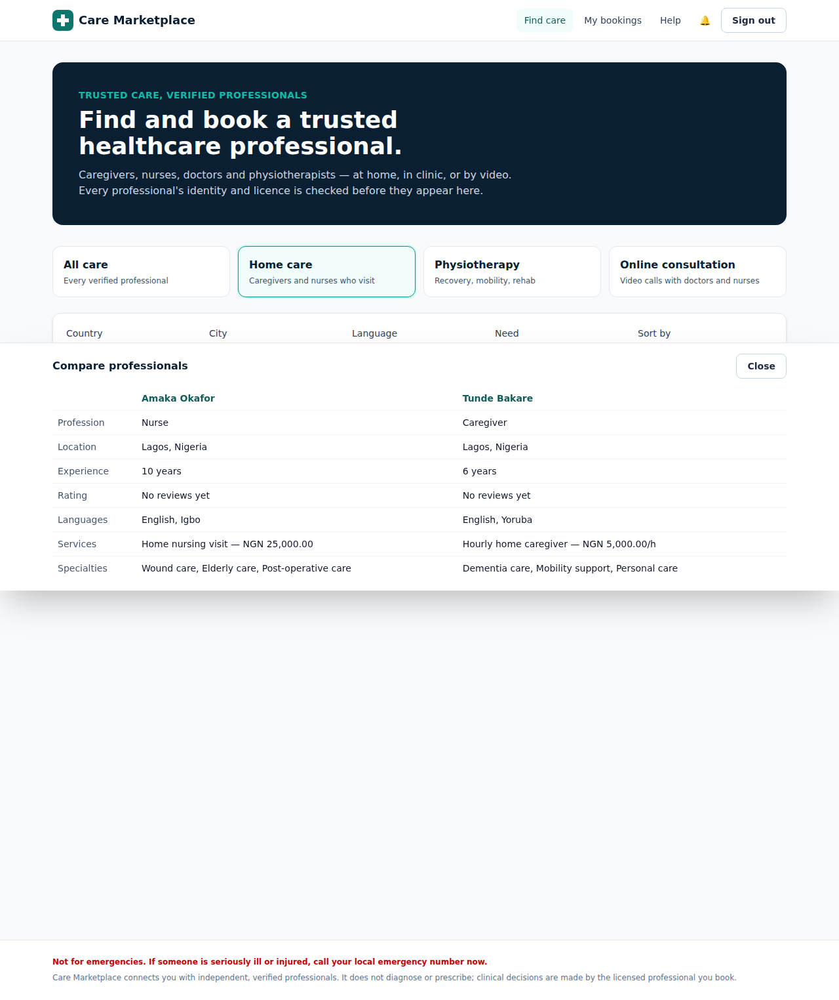
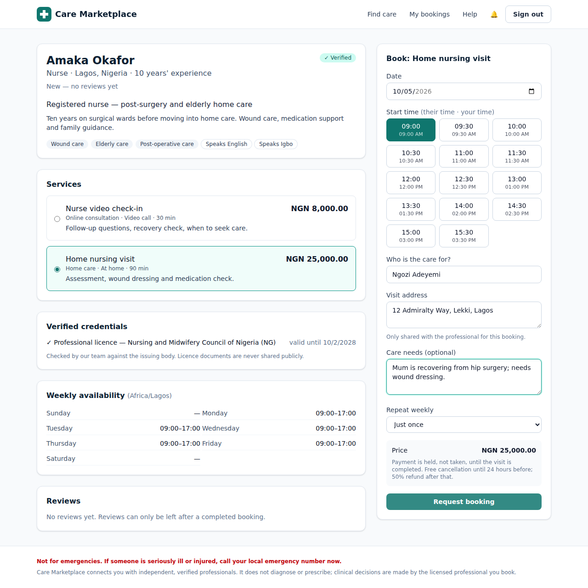
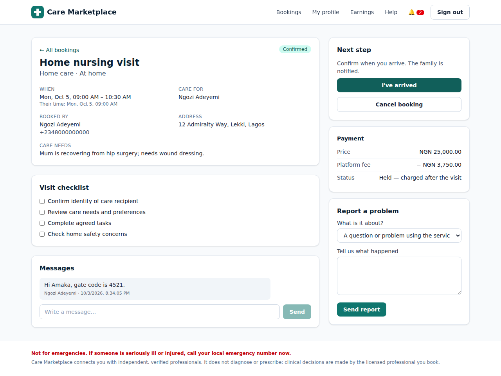
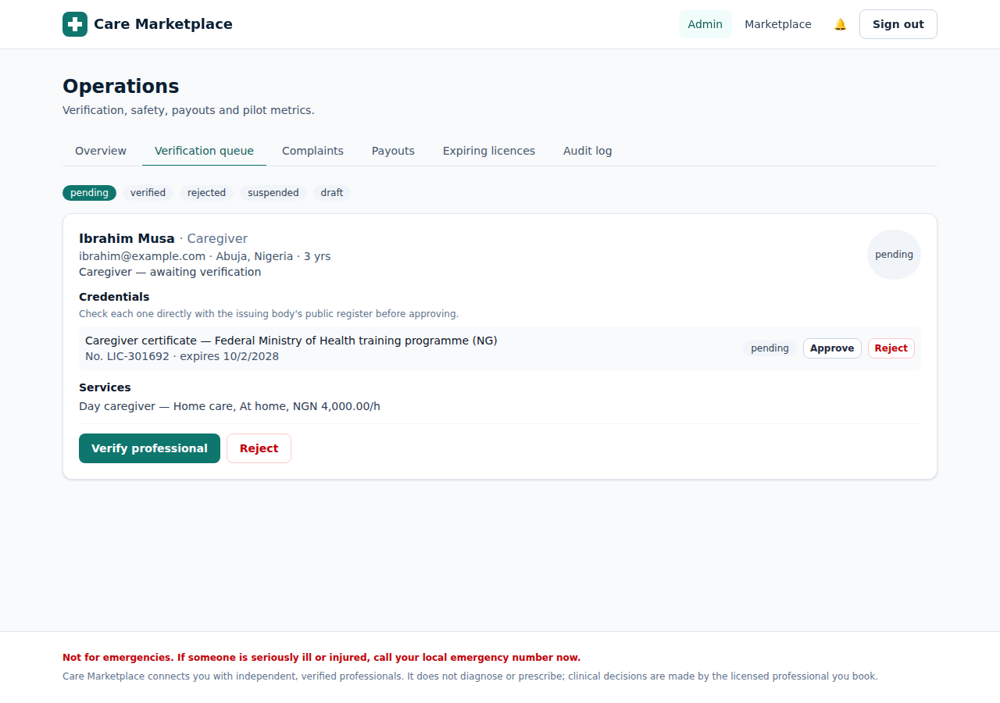

# Care Marketplace

A trusted marketplace for finding, comparing, booking and paying verified healthcare professionals: caregivers, nurses, doctors and physiotherapists. Visits can happen **at home**, **in clinic**, or **by video**.

This is Web App 1 from the *Three Focused Healthcare Web Apps* product concept. It covers the first-release scope from that document:

| Area | What's built |
|---|---|
| Accounts | Patient/family and provider sign-up, JWT sessions, admin role (seeded, not self-registrable) |
| Verification | Providers add licences/certificates; admins approve each credential, then verify the professional. Only verified providers holding an approved, unexpired credential appear in search or can be booked |
| Professional scope | Each profession can only offer services within its scope (e.g. caregivers: home care only; physios: physiotherapy only; telehealth is virtual-only), enforced server-side |
| Profiles | Services with fixed or hourly pricing in any currency, languages, specialties, service area, weekly availability in the provider's own time zone |
| Search & compare | Filter by category, country, city, language, need; sort by rating/price/experience; side-by-side comparison of up to 3 |
| Booking | Availability- and overlap-checked bookings, home address or telehealth consent, booking for a family member, weekly recurring care, times shown in both the provider's and patient's time zone |
| Payments | Funds are **authorized at booking** and **captured on completion**. Declines release the hold; cancellations follow a clear policy (full refund >24h before or by provider, 50% inside 24h with the provider compensated). Platform commission is configurable |
| Visit workflow | Accept/decline, “arrived”/“joined call”, per-category checklist, visit summary, completion → payout record |
| Telehealth | Unique video room link (Jitsi by default, configurable) revealed only after acceptance |
| Messaging & reminders | Per-booking messages, in-app notifications, 24h reminders, credential-expiry warnings |
| Trust & support | Reviews only after completed bookings, complaints/incident reports (safety reports alert admins immediately), support requests |
| Admin | Pilot metrics (completed bookings, repeat patients, cancellation rate, open complaints), verification queue, complaints workflow, payouts, expiring licences, immutable audit log |

Deliberately **not** included, as the concept recommends: medical records, prescriptions, insurance claims, hospital management, and AI diagnosis.

## Stack

```
backend/    Node 22 · Express 5 · TypeScript · Prisma 5 · PostgreSQL · Zod · Vitest
frontend/   React 19 · Vite · Tailwind CSS 4 · TanStack Query · React Router
```

## Running locally

Prerequisites: Node 20+ and PostgreSQL 14+.

```bash
# 1. Database
createdb care_marketplace            # or: docker run -e POSTGRES_PASSWORD=care -p 5432:5432 postgres:16

# 2. API (http://localhost:5100)
cd backend
cp .env.example .env                 # set DATABASE_URL and JWT_SECRET
npm install
npx prisma migrate deploy
npm run seed                         # demo users and providers in NG, KE, GH, GB, US
npm run dev

# 3. Web app (http://localhost:5173, proxies /api to the API)
cd ../frontend
npm install
npm run dev
```

### Demo accounts (after seeding)

| Role | Email | Password |
|---|---|---|
| Patient | patient@example.com | Patient@123 |
| Family member (UK) | family@example.com | Patient@123 |
| Provider (nurse, Lagos) | amaka@example.com | Provider@123 |
| Provider awaiting verification | ibrahim@example.com | Provider@123 |
| Admin | admin@care.example | Admin@12345 |

All seeded providers share the password `Provider@123`.

### Tests

```bash
cd backend
createdb care_marketplace_test        # or set TEST_DATABASE_URL
npm test
```

The integration suite covers the full lifecycle: onboarding, scope enforcement, verification gating, availability and double-booking checks, hourly pricing, payment hold → capture → payout, recurring bookings, cancellation refunds, credential expiry removing a provider from search, access control and safety-report alerts.

## Deploying a live site

The repo deploys as **one web service** (the API also serves the built web app) plus a **PostgreSQL** database.

**Render (easiest):** in the Render dashboard choose **New → Blueprint**, select this repository, and click **Apply**. `render.yaml` creates the database and the web service, generates `JWT_SECRET`, runs migrations on start, and loads the demo data on the first start only. Your site will be at `https://care-marketplace-<id>.onrender.com`. Free Render services sleep when idle, so the first visit can take ~30s; the free database expires after 30 days. Use paid plans for a real pilot.

**Anywhere else (Railway, Fly.io, a VPS):** use the `Dockerfile` and set `DATABASE_URL` and `JWT_SECRET` (plus `SEED_DEMO_DATA=true` if you want demo data).

> ⚠️ The demo accounts below, including the admin, have published passwords. Before real people sign up, set `SEED_DEMO_DATA=false`, and replace or delete the demo accounts (at minimum, change the admin password).

## Configuration

| Variable | Default | Purpose |
|---|---|---|
| `DATABASE_URL` | — | PostgreSQL connection string |
| `JWT_SECRET` | — | Long random secret for session tokens |
| `PORT` | `5100` | API port |
| `CORS_ORIGIN` | `http://localhost:5173` | Web app origin |
| `PLATFORM_FEE_PERCENT` | `15` | Commission on each booking |
| `PAYMENT_GATEWAY` | `mock` | Payment adapter (see below) |
| `VIDEO_BASE_URL` | `https://meet.jit.si` | Base URL for telehealth rooms |
| `LATE_CANCEL_HOURS` / `LATE_CANCEL_REFUND_PERCENT` | `24` / `50` | Cancellation policy |
| `REMINDER_LEAD_HOURS` | `24` | When appointment reminders go out |
| `STATIC_DIR` | — | Built web app to serve from the API (production) |
| `TRUST_PROXY` | `false` | Set `true` behind a hosting proxy so rate limits see real client IPs |
| `SEED_DEMO_DATA` | — | `true` loads demo data on start if the database is empty |

## Before a real pilot

This is a working MVP, not yet production-ready. Still to do:

1. **Real payments.** Only a `mock` gateway exists. Implement `PaymentGateway` in `backend/src/services/payments.ts` for the launch market (Stripe for card-first markets; Paystack, Flutterwave or M-Pesa for Africa), with webhooks and automated provider payouts. Admins currently mark payouts as paid by hand.
2. **Telehealth video.** Public Jitsi rooms are fine for demos but not for clinical consultations. Use a provider that offers a BAA/DPA (e.g. Daily, Twilio, Vonage) or self-host.
3. **Document uploads.** Credentials currently take a document *link*. Add private, encrypted file storage with signed URLs.
4. **Email/SMS/push.** Notifications are in-app only. Add email and SMS (critical for reminders in low-connectivity markets).
5. **Legal and privacy review for the launch jurisdiction.** Professional-scope rules (`backend/src/lib/scope.ts`), the cancellation policy, consent wording, data retention, and the regulatory status of telehealth all need local advice. This affects NDPA (Nigeria), the Data Protection Act (Kenya), GDPR (UK/EU) and HIPAA (US).
6. **Operational hardening.** Password reset and email verification, 2FA for admins, moving background jobs to a scheduler when running more than one API instance, monitoring, backups, and a penetration test.
7. **Accessibility and localization.** The UI is responsive with labelled forms. It still needs translation, and an audit with real users and screen readers.

The concept document's guidance still applies: launch in **one city** with a small, manually verified provider group and a few well-defined services, then watch booking completion, repeat use, cancellations, complaints and provider response time before expanding.

## Screenshots

| Search & compare | Booking |
|---|---|
|  |  |
| **Provider visit workflow** | **Admin verification queue** |
|  |  |
